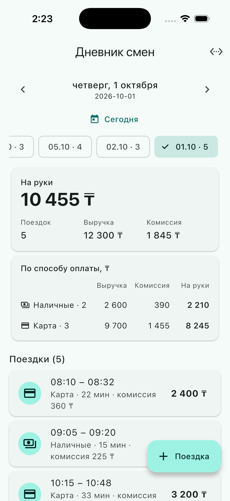
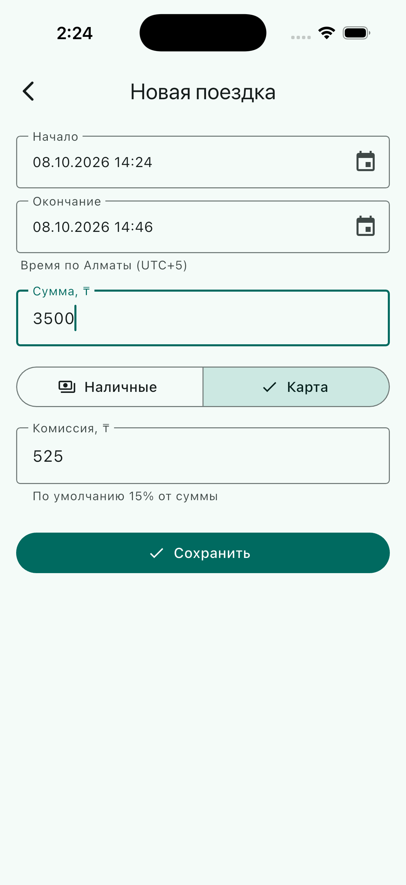
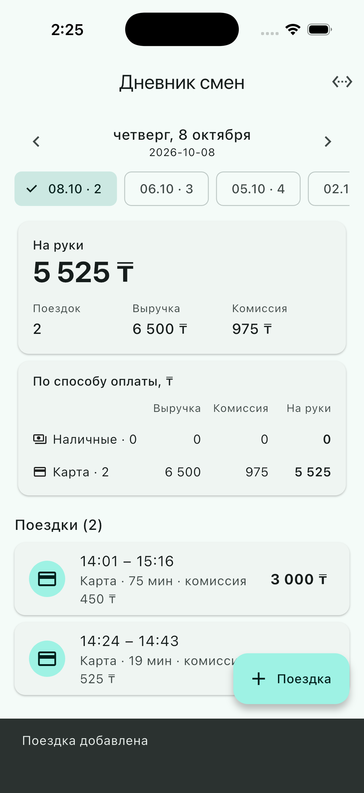

# Дневник смен водителя

Мини-приложение: сервер на **Dart** (чистый `dart:io`, без внешних пакетов) и мобильный клиент на **Flutter**.
Водитель видит сводку за день (поездки, выручка, комиссия, «на руки», наличные/карта), листает дни и добавляет поездки.

## Скриншоты

| Главный экран | Новая поездка | Поездка добавлена |
|---|---|---|
|  |  |  |


## Что сделано

| Пункт задания | Где |
|---|---|
| 1. API: список поездок дня и сводка дня | `GET /api/trips?date=`, `GET /api/summary?date=` — `server/lib/api.dart` |
| 2. Клиент: сводка, список, переключение дней | `app/lib/home_page.dart`, `app/lib/widgets.dart` |
| 3. Добавление поездки с проверкой и защитой от дублей | `POST /api/trips` — `server/lib/validate.dart`, `server/lib/store.dart`; форма — `app/lib/add_trip_page.dart` |
| 4. Тесты на сводку и на защиту от дублей | `server/test/summary_test.dart`, `server/test/store_test.dart`, `server/test/api_test.dart` |

Дополнительно: переключение дней стрелками, выбором даты и быстрыми «чипами» дней с поездками; поле адреса сервера в приложении; данные сервера сохраняются в JSON-файл.

## Структура

```
server/              сервер (Dart)
  bin/server.dart      точка входа
  lib/trip.dart        модель поездки, отпечаток содержимого
  lib/validate.dart    проверка входных данных
  lib/summary.dart     расчёт сводки
  lib/store.dart       хранилище, защита от дублей, границы дней
  lib/api.dart         HTTP API
  data/seed.json       демо-данные (пример из задания + ещё несколько дней)
  test/                тесты
app/                 клиент (Flutter)
  lib/                 экраны, виджеты, HTTP-клиент, форматирование
  test/                тесты форматирования и экранов
```

## Запуск

### Сервер

```bash
cd server
dart pub get
dart run bin/server.dart          # http://127.0.0.1:8080
```

Переменные окружения: `PORT` (8080), `HOST` (127.0.0.1), `DATA_FILE` (`server/data/trips.json`).
При первом запуске `data/trips.json` создаётся из `data/seed.json`. Чтобы достучаться с реального телефона в той же сети, запустите с `HOST=0.0.0.0`.

### Приложение

```bash
cd app
flutter create . --platforms=android,ios,web   # один раз: добавит папки платформ, существующие файлы не трогает
flutter pub get
flutter run
```

Адрес сервера:
- эмулятор Android — `http://10.0.2.2:8080` подставляется сам;
- iOS-симулятор, web, desktop — `http://localhost:8080`;
- реальный телефон — иконка «Адрес сервера» в шапке приложения или `flutter run --dart-define=API_BASE_URL=http://192.168.0.10:8080`.

Для **release-сборки Android** добавьте в `android/app/src/main/AndroidManifest.xml` разрешение `<uses-permission android:name="android.permission.INTERNET"/>` (в debug оно есть по умолчанию).

## API

| Метод и путь | Ответ |
|---|---|
| `GET /api/trips?date=YYYY-MM-DD` | `{date, trips: [...]}`, по возрастанию времени начала |
| `GET /api/summary?date=YYYY-MM-DD` | `{date, trips, revenue, commission, net, byPayment: {cash: {...}, card: {...}}}` |
| `GET /api/days` | `{days: [{date, trips}]}` — дни, в которые есть поездки |
| `POST /api/trips` | `201 {trip, duplicate: false}` — создана; `200 {trip, duplicate: true}` — такая поездка уже есть; `400` — ошибки по полям; `409` — id занят другими данными |

```bash
curl "http://127.0.0.1:8080/api/summary?date=2026-10-01"

curl -X POST http://127.0.0.1:8080/api/trips -H 'Content-Type: application/json' -d '{
  "id": "t100", "start": "2026-10-06T15:00:00+05:00", "end": "2026-10-06T15:20:00+05:00",
  "amount": 2000, "payment": "cash", "commission": 300 }'
```

Проверка данных: сумма > 0 (до 2 знаков после запятой), окончание строго позже начала, способ оплаты `cash` или `card`, комиссия от 0 до суммы, время — ISO 8601 со смещением (несуществующие даты вроде 31 февраля отклоняются).

## Защита от дублей

Повторная отправка той же поездки не создаёт дубль — на трёх уровнях:

1. **Тот же `id` и те же данные** → `200`, `duplicate: true`, запись одна.
2. **Тот же `id`, но другие данные** → `409`: тихо перезаписывать или плодить запись нельзя.
3. **Другой `id`, но те же данные** (время, сумма, оплата, комиссия) → тоже повтор: водитель не может провести две одинаковые поездки в одно время. Время сравнивается как момент, поэтому `+05:00` и `Z` дают один результат.

Если `id` не передан, он выводится из содержимого поездки. Приложение создаёт `id` один раз при открытии формы и не меняет при повторном нажатии «Сохранить», поэтому обрыв связи не приводит к дублю. Защита работает и после перезапуска сервера (данные хранятся в файле).

## Допущения

- Границы дней считаются по времени водителя, **UTC+5** (Алматы), день поездки определяется по времени начала. Поездка в 23:59 (+05:00) относится к этому дню, в 00:00 — уже к следующему.
- Деньги считаются в целых копейках, чтобы не копились ошибки `double` (`0.1 + 0.2`).
- «На руки» = выручка − комиссия.
- Хранилище — JSON-файл с атомарной записью; для учебного проекта этого достаточно, для продакшена нужна БД и авторизация (водитель, смены).

## Тесты

```bash
cd server && dart test      # сводка, валидация, защита от дублей, границы дней, HTTP API
cd app && flutter test      # форматирование, экраны с заглушкой сервера
```

## Что проверено

- **Сервер.** `dart analyze` без замечаний, `dart test` — 49 тестов проходят (сводка, валидация, защита от дублей, границы дней, HTTP API). Сервер запускался и проверялся через `curl`.
- **Клиент.** `flutter analyze` без замечаний, `flutter test` — 11 тестов проходят (форматирование, экраны с заглушкой сервера). Приложение запускалось на симуляторе iPhone вместе с сервером.


## Как использовался ИИ

Приложение собрано с помощью Claude (Claude Code): ИИ написал сервер, клиент, тесты и README по тексту задания.

Где ИИ ошибся и что обнаружилось при проверке:

- **Стек.** Сначала ИИ начал делать сервер и веб-клиент на Node.js; по моему запросу всё переписано на Dart/Flutter.
- **Валидация.** При некорректной сумме (например, `0`) сервер дополнительно сообщал «комиссия больше суммы». Два теста, написанные тем же ИИ, это поймали; исправлено — комиссия сравнивается с суммой, только если сама сумма корректна.
- **Импорты.** `BytesBuilder` импортировался через `dart:io` (устаревший путь, нужен `dart:typed_data`), плюс остался неиспользуемый импорт — нашёл `dart analyze`.


Что я нашёл и исправил сам, запустив приложение на симуляторе iPhone:

- При первом запуске приложение показывало ошибки 404 и 501. Через `curl -i` я увидел, что на порту 8080 отвечает не наш сервер, а Python `SimpleHTTP`, а `lsof -i :8080` показал этот процесс. Я запустил наш сервер на порту 8090 и указал новый адрес в приложении. Недочёт ИИ здесь в удобстве: приложение писало «неожиданный ответ (404)» и не подсказывало, что по адресу отвечает чужой сервер. Сообщение переписали.
- По скриншоту заметил, что при ошибке загрузки нового дня приложение оставляло на экране цифры прошлого дня под новой датой, а таблица «наличные/карта» на iPhone была тесной. ИИ исправил, добавили тест.
- В форме «Новая поездка» по умолчанию стояла дата открытого на главном экране дня, а не сегодняшняя. Исправили.